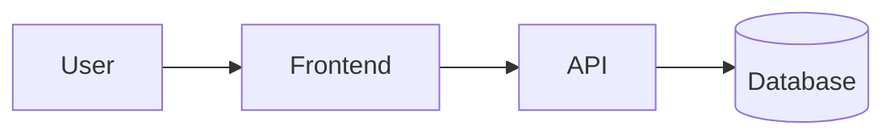

# 系統架構：<專案名稱>

- 對應 PRD：[01-prd.md](01-prd.md)
- 最後更新：YYYY-MM-DD

## 影響架構的需求與限制
- <資料量、使用者數、即時性、成本、技術背景……>

## 選定方案
<簡述最後選擇的方案；其他方案與取捨記錄在 ADR>

## 系統元件


## 核心資料模型
<主要實體與關係>

## 技術棧
| 層 | 技術 | 版本 | 相關 ADR |
|---|---|---|---|
| 前端 | | | |
| 後端 | | | |
| 資料庫 | | | |

## 專案目錄結構
```
<...>
```

## 測試策略
- 單元測試：<工具>
- 整合測試：<工具>
- 端對端測試：<工具>

## 部署與 CI
- <部署平台、CI 流程>

## 待驗證項目（Spike）
- [ ] <要驗證的問題> → 結論寫回：<文件>
